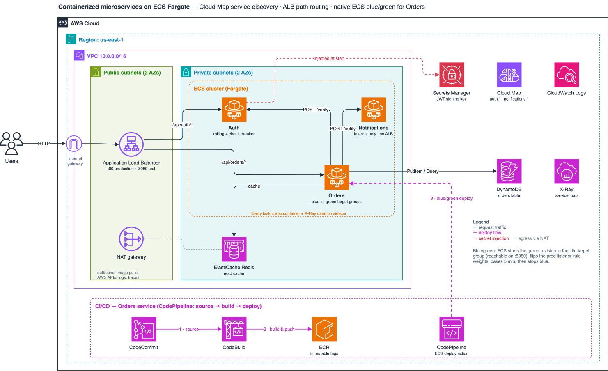

# Containerized Microservices with ECS Fargate and Service Discovery

A monolith split into three microservices — **Auth**, **Orders**, **Notifications** —
running on Amazon ECS Fargate, communicating via AWS Cloud Map service discovery,
fronted by an Application Load Balancer, with blue/green CI/CD for the Orders service
via CodePipeline and native ECS blue/green deployments, DynamoDB for order storage, a
shared Redis cache, and Secrets Manager-backed JWT signing.



## Table of contents
- [Architecture overview](#architecture-overview)
- [AWS services used](#aws-services-used)
- [Repository structure](#repository-structure)
- [Prerequisites](#prerequisites)
- [Running locally](#running-locally)
- [Deployment](#deployment)
- [Setting up the Orders CI/CD pipeline](#setting-up-the-orders-cicd-pipeline)
- [Testing the application](#testing-the-application)
- [Testing blue/green deployment](#testing-bluegreen-deployment)
- [Testing X-Ray tracing](#testing-x-ray-tracing)
- [Extending blue/green to Auth and Notifications](#extending-bluegreen-to-auth-and-notifications)
- [Security notes](#security-notes)
- [Known limitations](#known-limitations)
- [Cleanup](#cleanup)

---

## Architecture overview

```
Client
  │
  ▼
Application Load Balancer  (:80 production, :8080 blue/green test listener)
  │  /api/auth/*                   │  /api/orders, /api/orders/*
  ▼                                ▼
Auth service (ECS Fargate)     Orders service (ECS Fargate, native ECS BLUE_GREEN)
  │  signs/verifies JWTs            │  calls Auth /verify via Cloud Map DNS
  │  (key from Secrets Manager)     │  stores orders in DynamoDB
  │                                 │  caches each user's order list in Redis
  │                                 │  calls Notifications via Cloud Map DNS
  ▼                                 ▼
Cloud Map: auth.internal...    Notifications service (ECS Fargate, internal only)
                               Cloud Map: notifications.internal... (no ALB target)
```

Every task runs two containers: the application and an **X-Ray daemon sidecar**. Orders
instruments its outgoing HTTP calls and its DynamoDB client, so a request shows up as one
connected trace in the X-Ray service map (`Orders → Auth`, `Orders → Notifications`,
`Orders → DynamoDB`), not as isolated per-service traces.

## AWS services used

| Service | Role |
|---|---|
| **Amazon ECS (Fargate)** | Runs all three services; no EC2 instances to patch or manage |
| **Amazon ECR** | Private image registry per service: scan-on-push, immutable tags, lifecycle policy |
| **Application Load Balancer** | Path-based routing to Auth and Orders; a second "test" listener (port 8080) exposes the green Orders revision during a blue/green deployment |
| **AWS Cloud Map** | Private DNS namespace (`internal.saa-microservices.local`) for service-to-service discovery |
| **AWS Secrets Manager** | Stores the JWT signing key, injected into the Auth container at startup — never hardcoded |
| **Amazon DynamoDB** | Durable order storage, shared by every Orders task and deployment revision |
| **Amazon ElastiCache (Redis)** | Shared read cache in front of the order list |
| **AWS CodePipeline / CodeCommit / CodeBuild** | CI/CD for Orders; the pipeline's ECS deploy action triggers a blue/green deployment |
| **AWS X-Ray** | Distributed tracing across the services via a per-task sidecar daemon |
| **AWS CloudFormation** | Infrastructure as code, split into five ordered stacks |

## Repository structure

```
ecs-microservices-platform/
├── infra/
│   ├── 00-ecr.yaml              # ECR repos (own stack, so images can be pushed before services exist)
│   ├── 01-network.yaml          # VPC, subnets, NAT, security groups
│   ├── 02-cluster.yaml          # ECS cluster, Cloud Map namespace, ALB + listeners, Redis, JWT secret
│   ├── 03-services.yaml         # DynamoDB table, IAM, task defs (+X-Ray sidecar), ECS services, target groups
│   └── 04-pipeline-orders.yaml  # CodeCommit + CodeBuild + CodePipeline (ECS deploy action)
├── services/
│   ├── auth/            (Dockerfile, package.json, package-lock.json, server.js)
│   ├── orders/          (Dockerfile, package.json, package-lock.json, server.js, buildspec.yml)
│   └── notifications/   (Dockerfile, package.json, package-lock.json, server.js)
├── deploy/
│   ├── build-and-push.sh        # Builds + pushes all three images to ECR
│   └── deploy-stacks.sh         # Deploys everything in order (stacks + images)
├── docker-compose.yml           # Local stack: services + Redis + DynamoDB Local + an ALB-like gateway
├── local/nginx.conf             # Gateway routing that mirrors the ALB listener rules
└── diagrams/
    ├── architecture.drawio      # Editable source (open in app.diagrams.net)
    └── architecture.svg         # Exported diagram shown above
```

## Prerequisites

- AWS CLI v2 configured with permissions for ECS, ECR, EC2/VPC, ElastiCache, DynamoDB,
  Secrets Manager, CodePipeline/CodeBuild/CodeCommit, IAM, and CloudFormation.
- Docker installed locally (to build and push the three images).
- An AWS account — this project provisions real billable resources (NAT Gateway, ALB,
  ElastiCache, Fargate tasks). Remember to run the [cleanup](#cleanup) steps when done.

## Running locally

```bash
docker compose up --build
```

This starts the three services, Redis, DynamoDB Local (with the Orders table created),
and an nginx gateway on `http://localhost:8000` that routes paths the same way the ALB
does. Use the commands in [Testing the application](#testing-the-application) with
`ALB_DNS=localhost:8000`. X-Ray is disabled locally (there is no daemon).

## Deployment

The ECR repositories live in their own stack (`00-ecr.yaml`), so the images can be
pushed before the ECS services are created and no placeholder-image bootstrap is needed.
One script does the whole ordered deployment:

```bash
git clone <your-fork-url> ecs-microservices-platform
cd ecs-microservices-platform

# Optional: allow your IP to reach the blue/green test listener on :8080
export TEST_LISTENER_CIDR="$(curl -s https://checkip.amazonaws.com)/32"

./deploy/deploy-stacks.sh us-east-1
```

It deploys, in order: `01-network` → `02-cluster` → `00-ecr` → builds and pushes the
three images (tagged with a timestamp, since ECR tags are immutable) → `03-services` →
`04-pipeline-orders`, then prints the ALB DNS name. It is safe to re-run; on re-runs it
keeps the Orders image that is currently deployed, since the pipeline owns Orders releases.

<details>
<summary>Equivalent manual steps</summary>

```bash
REGION=us-east-1
ACCOUNT_ID=$(aws sts get-caller-identity --query Account --output text)
REGISTRY=$ACCOUNT_ID.dkr.ecr.$REGION.amazonaws.com/saa-microservices
TAG=v1

aws cloudformation deploy --region $REGION --stack-name saa-microservices-network \
  --template-file infra/01-network.yaml
aws cloudformation deploy --region $REGION --stack-name saa-microservices-cluster \
  --template-file infra/02-cluster.yaml
aws cloudformation deploy --region $REGION --stack-name saa-microservices-ecr \
  --template-file infra/00-ecr.yaml

./deploy/build-and-push.sh "$ACCOUNT_ID" $REGION $TAG

aws cloudformation deploy --region $REGION --stack-name saa-microservices-services \
  --template-file infra/03-services.yaml --capabilities CAPABILITY_NAMED_IAM \
  --parameter-overrides AuthImage=$REGISTRY/auth:$TAG OrdersImage=$REGISTRY/orders:$TAG \
    NotificationsImage=$REGISTRY/notifications:$TAG

aws cloudformation deploy --region $REGION --stack-name saa-microservices-pipeline-orders \
  --template-file infra/04-pipeline-orders.yaml --capabilities CAPABILITY_IAM
```
</details>

Get the ALB's public DNS name:

```bash
aws cloudformation describe-stacks --region us-east-1 --stack-name saa-microservices-cluster \
  --query "Stacks[0].Outputs[?OutputKey=='AlbDnsName'].OutputValue" --output text
```

## Setting up the Orders CI/CD pipeline

`04-pipeline-orders.yaml` creates an **empty** CodeCommit repository. Push the Orders
service source into it so the pipeline has something to build:

```bash
CLONE_URL=$(aws cloudformation describe-stacks --region us-east-1 \
  --stack-name saa-microservices-pipeline-orders \
  --query "Stacks[0].Outputs[?OutputKey=='CodeCommitCloneUrlHttp'].OutputValue" --output text)

cd services/orders
git init
git remote add origin "$CLONE_URL"
git add .
git commit -m "Initial Orders service"
git push origin HEAD:main
```

Pushing to `main` triggers the pipeline: CodeBuild builds the Docker image, pushes it to
ECR with a unique tag, and writes `imagedefinitions.json`. The ECS deploy action then
copies the service's current task definition, swapping only the `app` image. Environment
variables, secrets, the X-Ray sidecar and roles therefore always match `03-services.yaml`,
and there is no second task definition to keep in sync. Because the Orders service uses the
`BLUE_GREEN` deployment strategy, that update runs as a blue/green deployment.

## Testing the application

```bash
ALB_DNS=$(aws cloudformation describe-stacks --region us-east-1 --stack-name saa-microservices-cluster \
  --query "Stacks[0].Outputs[?OutputKey=='AlbDnsName'].OutputValue" --output text)

# Log in
TOKEN=$(curl -s -X POST "http://$ALB_DNS/api/auth/login" \
  -H "Content-Type: application/json" \
  -d '{"username":"demo","password":"demo1234"}' | jq -r .token)

# Create an order (Orders calls Auth's /verify over Cloud Map internally)
curl -X POST "http://$ALB_DNS/api/orders" \
  -H "Authorization: Bearer $TOKEN" -H "Content-Type: application/json" \
  -d '{"item":"AWS SAA voucher","quantity":1}'

# List your orders: "source":"origin" (DynamoDB) first, then "cache" (Redis) for 30s
curl "http://$ALB_DNS/api/orders" -H "Authorization: Bearer $TOKEN"
```

Creating an order also fires a background call from Orders to the internal
Notifications service. You won't see that response directly (it's fire-and-forget),
but you can confirm it happened by checking the Notifications service logs in
CloudWatch (`/ecs/saa-microservices/notifications`) for a line like:

```
[notification] 2025-01-01T00:00:00.000Z — Order <id> placed for 1x AWS SAA voucher
```

## Testing blue/green deployment

1. Make a small, visible change to `services/orders/server.js` (e.g. add a new field to
   the order response) and push to the CodeCommit `main` branch.
2. Watch the pipeline in the **CodePipeline console** — Source → Build → Deploy.
3. During the Deploy stage, open **ECS console → Cluster → saa-microservices-orders →
   Deployments**. ECS starts the green revision in the idle target group, where it is
   reachable on the test listener before it takes live traffic. You need
   `TEST_LISTENER_CIDR` set to your IP (see [Deployment](#deployment)):
   ```bash
   curl "http://$ALB_DNS:8080/api/orders" -H "Authorization: Bearer $TOKEN"
   ```
4. ECS then flips the production listener-rule weights to green and **bakes for 5
   minutes** with blue still running. A failure during that window rolls back instantly by
   flipping the weights back. After the bake, the blue tasks are stopped. Orders are kept
   in DynamoDB, so nothing is lost across the switch.

## Testing X-Ray tracing

1. Log in and create a few orders as above.
2. Open **CloudWatch console → X-Ray traces → Trace map** (or the X-Ray service map).
3. You should see a connected graph, `orders-service → auth-service`,
   `orders-service → notifications-service` and `orders-service → DynamoDB`, with
   latency on each hop. Screenshot it for your submission: it's the clearest evidence
   that the microservices talk to each other over Cloud Map rather than running as
   independently deployed silos.

## Extending blue/green to Auth and Notifications

`04-pipeline-orders.yaml` is written as the **representative** pipeline the project
brief asks for. To replicate it for Auth:

1. In `03-services.yaml`, add a second target group for Auth, change `AuthListenerRule`
   to a weighted forward over both groups (like `OrdersProdListenerRule`), add a test
   listener rule, and give `AuthService` the same `DeploymentConfiguration`
   (`Strategy: BLUE_GREEN`) and `AdvancedConfiguration` block as `OrdersService`.
2. Copy `infra/04-pipeline-orders.yaml` to `infra/05-pipeline-auth.yaml` and replace
   every `orders` reference (repo name, ECR repo, service name, roles) with `auth`.
3. Copy `services/orders/buildspec.yml` into `services/auth/`.

Notifications has no load balancer, so ECS can't shift traffic for it. Keep its rolling
deployment (with the circuit breaker already enabled) and use the same pipeline shape.
The ECS deploy action performs a rolling update for it.

## Security notes

- Each service has its **own IAM task role**, scoped to what it needs (Orders:
  `PutItem`/`Query` on its table; everyone: X-Ray writes). Auth also has its **own
  execution role**, the only one allowed to read the JWT secret, so no other task
  definition can have the key injected.
- The JWT signing key lives only in Secrets Manager and is injected into the Auth
  container's environment by ECS (via the task definition's `Secrets` field). It never
  appears in code, image layers, or CloudFormation parameters. Auth refuses to start
  without it.
- Orders does **not** hold the JWT secret; it validates tokens by calling Auth's
  `/verify` endpoint over Cloud Map. `/verify` sits outside `/api/auth`, so the ALB
  never routes to it.
- Notifications has no ALB target group and can't be reached from the internet. It
  resolves only via Cloud Map DNS, from inside the ECS security group.
- Redis is reachable only from the ECS security group. The test listener (`:8080`) is
  VPC-only unless you open it to your own IP with `TEST_LISTENER_CIDR`.
- `AssignPublicIp: DISABLED` on all three services means no task gets a public IP. All
  inbound traffic comes through the ALB; outbound traffic goes through the NAT Gateway.
- Containers run as the non-root `node` user, from `npm ci`-installed, lockfile-pinned
  dependencies.

## Known limitations

These are deliberate simplifications for a course project. Each one is worth naming in a
write-up:

- **HTTP only.** Tokens cross the internet in cleartext. Production needs an ACM
  certificate, an HTTPS listener, and HTTP→HTTPS redirects.
- **Demo auth.** One hardcoded user with a plaintext password and no rate limiting on
  `/login`. Use Cognito (or a user table with bcrypt) and AWS WAF rate rules.
- **One NAT Gateway**, so egress for both AZs depends on AZ 1. There are no VPC
  endpoints (ECR, Logs, Secrets Manager, S3, DynamoDB), which costs NAT data-processing
  fees.
- **Redis** is a single node with no AUTH and no in-transit/at-rest encryption. A
  replication group with Multi-AZ, TLS and AUTH would fix all three.
- **One shared ECS security group.** Per-service groups would stop, for example, Auth
  from calling Notifications.
- **No autoscaling policies or CloudWatch alarms.** Adding alarms to the Orders
  `DeploymentConfiguration` would make blue/green roll back automatically on errors.
- **X-Ray SDK** is in maintenance mode; new projects should use AWS Distro for
  OpenTelemetry (ADOT).
- **Notifications history** is an in-memory, per-task demo buffer. Durable delivery
  would use SQS/SNS.

## Cleanup

Stacks must be deleted in reverse order (each later stack imports values from the ones
before it). Empty the pipeline's artifact bucket first; the ECR repos empty themselves
(`EmptyOnDelete`).

```bash
REGION=us-east-1
BUCKET=$(aws cloudformation describe-stacks --region $REGION --stack-name saa-microservices-pipeline-orders \
  --query "Stacks[0].Outputs[?OutputKey=='ArtifactBucketName'].OutputValue" --output text)
aws s3 rm "s3://$BUCKET" --recursive

for stack in pipeline-orders services ecr cluster network; do
  aws cloudformation delete-stack --region $REGION --stack-name saa-microservices-$stack
  aws cloudformation wait stack-delete-complete --region $REGION --stack-name saa-microservices-$stack
done
```
